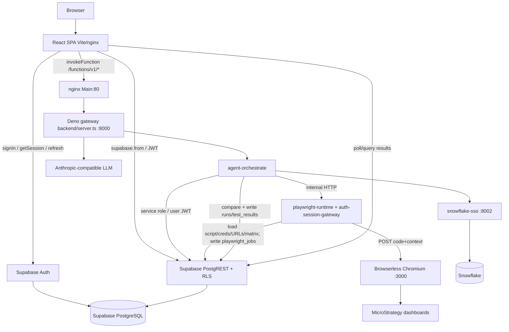
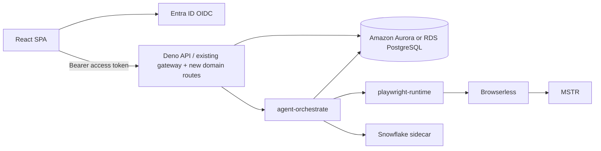
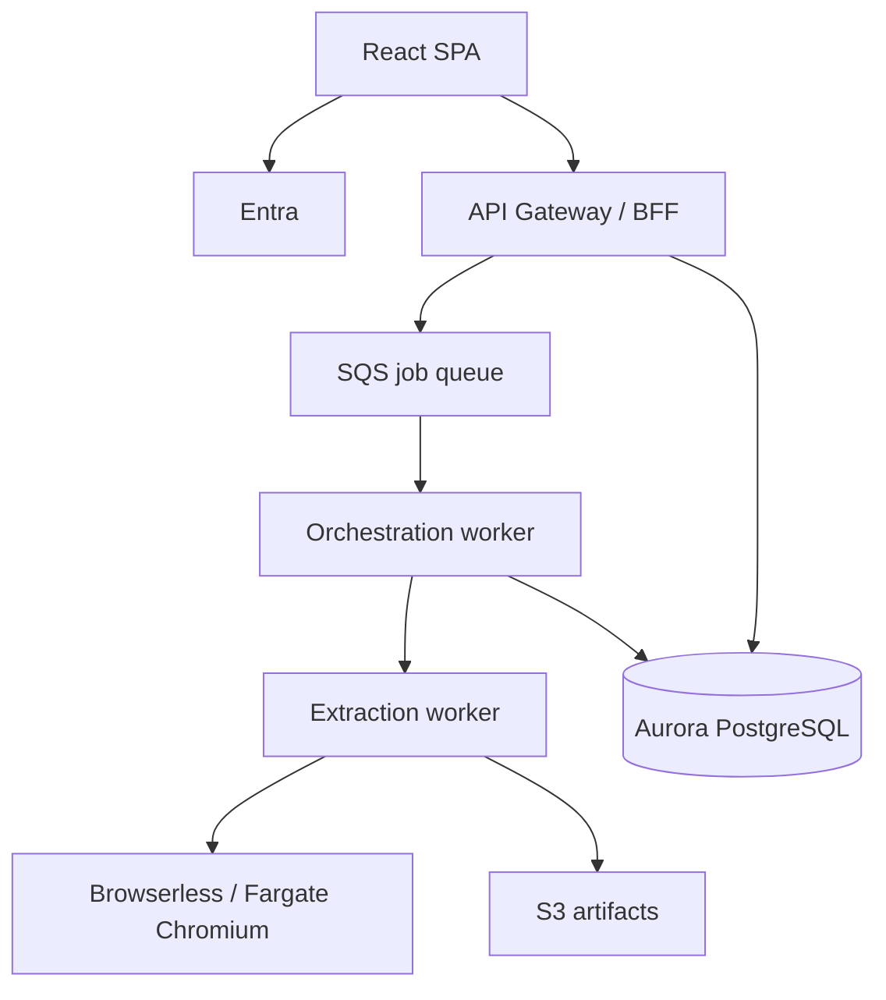

# Report Test Buddy — Target Architecture and Migration Assessment

**Document type:** Read-only architecture and migration analysis  
**Scope:** Remove dependency on Lovable Cloud / hosted Supabase for Auth + Database  
**Date:** 2026-11-05  
**Constraint:** No source changes, migrations, env changes, package installs, or service restarts were performed for this assessment.

---

# 1. Executive Summary

Report Test Buddy (RTB) is **not** “a Postgres app that happens to use Supabase.” It is a **Supabase Auth + PostgREST + RLS application** with a **self-hosted Deno function gateway** (local/`backend/server.ts` / AWS ECS) that already runs compute outside Lovable Cloud.

| Finding | Detail |
|---|---|
| What blocks login today | Browser → **Supabase Auth** (`VITE_SUPABASE_URL`). If Lovable Cloud hosts/proxy that Supabase project and it is down, **login fails even when AWS ECS is healthy**. |
| What Supabase is used for | Auth, Postgres, PostgREST, RLS, a few SECURITY DEFINER RPCs, Auth Admin API. **Not** Realtime. **Not** Storage in app runtime. **Not** primary Edge hosting on AWS. |
| What Lovable specifically adds | Preview host routing (`*.lovable.app` / `*.lovableproject.com`), leftover AI-gateway headers, docs/scaffolding, unused `LOVABLE_API_KEY`. Production AWS path already prefers same-origin Deno. |
| Playwright / MSTR risk | **Low** if migration is limited to data-access layers. Browserless call shape, saved scripts, filter core, and selectors must stay untouched. |
| Recommended direction | **Target A (lowest risk):** keep current ECS Deno gateway + Browserless + Snowflake sidecar; move DB to **Amazon RDS/Aurora PostgreSQL**; replace Auth with **Microsoft Entra ID (OIDC)** (corporate fit) or Cognito; gradually move SPA PostgREST calls behind a BFF. |
| Feasibility | **Yes, without a full rewrite**, if done in phases with repository abstraction, dual-read/shadow validation, and a freeze/cutover window. Frontend PostgREST surface (~229 `.from()` calls) is the largest rewrite cost. |

**Verdict:** Migrate Auth + Postgres off hosted Supabase/Lovable; keep extraction stack (Deno gateway, `agent-orchestrate`, `playwright-runtime` contract, Browserless, MSTR, Snowflake) intact. Prefer Entra + Aurora/RDS over “another SaaS Auth/DB combo.”

---

# 2. Current Architecture

## 2.1 End-to-end request path (traced from code)



## 2.2 Component catalog

| Component | Responsibility | Entry point | Upstream | Downstream | Auth | Data R/W | Failure impact | Deploy location |
|---|---|---|---|---|---|---|---|---|
| React SPA | UI, CRUD via PostgREST, start runs | `src/main.tsx`, `src/App.tsx` | Browser | Supabase Auth/DB, `/functions/v1` | Supabase session JWT | Nearly all domain tables | App unusable | Vite :8080 / nginx :80 ECS Main |
| AuthContext + ProtectedRoute | Session + admin gate | `src/contexts/AuthContext.tsx`, `ProtectedRoute.tsx` | SPA | `auth.*`, `user_roles` | Supabase Auth | `user_roles` read | Login/route lockout | SPA |
| Supabase JS client | Auth + PostgREST | `src/integrations/supabase/client.ts` | SPA | Hosted Supabase project | Anon key + user JWT | All FE tables | Total data/auth outage | Browser → cloud |
| Deno gateway | Host edge handlers in-process | `backend/server.ts` | nginx / Vite proxy | `supabase/functions/*` | Bearer JWT / service role | Via handlers | Runs/agents down; UI static may still load | ECS backend :8000 |
| `agent-orchestrate` | Concurrency, compare, persist runs | `supabase/functions/agent-orchestrate/index.ts` | UI / schedule-tick / trigger-run | playwright-runtime, warehouse, analyze, Postgres | `requireAuth` + service role or RunSession | `runs`, `test_results`, scripts, finalize RPC | Brand/scenario execution fails | Deno process |
| `playwright-runtime` | Wrap script, call Browserless, job rows | `…/playwright-runtime/index.ts` | orchestrate / UI | Browserless, Postgres | `requireAuth` | Read scenario/script/creds/URLs/matrix; write `playwright_jobs` | Extraction fails | Deno (gateway wrap) |
| auth-session-gateway | MSTR cookie reuse on disk | `_shared/auth-session-gateway.ts` | gateway wrap | `.auth-sessions/` FS, DB profile id | N/A (MSTR cookies) | Credential profile id lookup | Slower re-login; not Supabase Auth | ECS local disk |
| Browserless | Headless Chromium | env `BROWSERLESS_HOST` | playwright-runtime | MSTR HTTPS | Token query param | None (DB) | No extraction | ECS browserless :3000 |
| snowflake-sso | Warehouse auth/SQL | FastAPI :8002 | run-warehouse-sql | Snowflake | Connector secrets | Connector rows (via backend) | SQL compare path fails | ECS sidecar |
| LLM helpers | Script gen/repair/analyze | `_shared/llm.ts` | agent-* | Provider HTTP + `llm_providers` table | Service/anon client | Provider config | Gen/heal/analyze degraded | Deno |
| AWS ECS Express | Production hosting | task def `rtb` | Internet ALB | 4 containers | Secrets Manager | N/A | Full cloud outage | AWS us-east-1 |
| Hosted Supabase / Lovable Cloud | Auth + DB + optional Edge | `*.supabase.co` (project) | SPA + backend | Postgres | Supabase keys | All persistent state | **Login + CRUD + run persistence outage** | External SaaS |

## 2.3 Function hosting reality

`backend/server.ts` loads:

`admin-users`, `agent-analyze`, `agent-heal`, `agent-heal-script`, `agent-orchestrate`, `agent-scenarios`, `agent-scrape`, `agent-scripts`, `script-agent-chat`, `bootstrap-admin`, `playwright-runtime`, `run-warehouse-sql`, `schedule-tick`, `test-warehouse-connectivity`, `trigger-run`.

`src/lib/functions.ts` defaults to **same-origin** `/functions/v1/*` (Vite proxy / nginx → Deno). Hosted Edge is used only if `VITE_USE_CLOUD_FUNCTIONS=true` **or** hostname matches Lovable preview domains. Hosted Edge is avoided for Playwright (150s idle kill).

## 2.4 Deployment topology (current AWS)

```
Internet HTTPS → ECS Express ALB → Fargate task
  Main (nginx+SPA :80)
  backend (Deno :8000)  ←── Secrets: SUPABASE_*, BROWSERLESS_TOKEN
  browserless (:3000)
  snowflake-sso (:8002)
        │
        └── HTTPS → Supabase Cloud (Auth + Postgres)
                 → MSTR / Snowflake / LLM egress
```

Local: `run-rtb-local.ps1` / Compose mirrors the same four services; SPA still points `VITE_SUPABASE_*` at the cloud project.

## 2.5 Platform adapters (aspirational, unused by pages)

`src/lib/platform/index.ts` documents Lovable Cloud vs AWS, but **no `src/pages` / `src/components` import it**. Pages call `supabase` and `invokeFunction` directly. `VITE_PLATFORM_PROVIDER` does not switch implementations today. Migration cannot be a flag flip.

---

# 3. Supabase/Lovable Dependency Map

## 3.1 Classification legend

| Class | Meaning |
|---|---|
| A | Authentication |
| B | Database / PostgREST |
| C | Authorization / RLS |
| D | RPC / stored procedures |
| E | Storage |
| F | Realtime |
| G | Function hosting |
| H | Generated types |
| I | Environment / configuration |
| J | Deployment / runtime |

## 3.2 Master dependency table (representative)

| File | Function / surface | Dependency | Why | Class | Replace with | Diff | Risk |
|---|---|---|---|---|---|---|---|
| `package.json` | npm | `@supabase/supabase-js` | Browser client | A,B,G | OIDC client + API client | L | L |
| `src/integrations/supabase/client.ts` | `createClient` | `VITE_SUPABASE_URL` + publishable key | SPA singleton | A,B,I | Auth SDK + BFF client | M | H |
| `src/integrations/supabase/types.ts` | `Database` | Generated PostgREST types | Typed queries (partially stale) | H | Hand/codegen from PG | M | M |
| `src/contexts/AuthContext.tsx` | `onAuthStateChange`, `getSession`, `signOut`, `user_roles` | Auth + roles | Session + admin | A,B,C | OIDC session + roles API | M | H |
| `src/pages/Auth.tsx` | `signInWithPassword`, bootstrap-admin | Password login | Entry | A,G | IdP login / callback | M | H |
| `src/pages/Profile.tsx` | `auth.updateUser` | Password change | Profile | A | IdP account mgmt | L | M |
| `src/lib/functions.ts` | session refresh, `functions.invoke`, Lovable host check | JWT + routing | All agent calls | A,G,I,J | Keep fetch BFF; swap token source | H | Crit |
| ~28 FE modules | `supabase.from(...)` (~229 calls) | PostgREST | Primary CRUD | B | BFF REST/GraphQL or PostgREST proxy | H | H |
| `supabase/functions/_shared/auth.ts` | `createClient`, `requireAuth` | URL + anon/service | Gate + DB clients | A,B,C | JWT verify + PG pool | H | Crit |
| `_shared/run-session.ts` | `/auth/v1/token` refresh | Supabase Auth API | Long runs | A | IdP refresh / opaque session store | H | H |
| `_shared/internal-functions.ts` | Edge vs local URL | `SUPABASE_URL` / EdgeRuntime | Fn→fn | G,J | Always local/ECS URL | M | M |
| `_shared/llm.ts` | `createClient` | Service client | Load LLM config | B | Repository | M | M |
| `admin-users`, `bootstrap-admin` | `auth.admin.*` | Auth Admin API | User CRUD | A,C | IdP Admin / SCIM | M | Crit |
| `agent-orchestrate` | `.rpc("finalize_workstream_report")` | SECURITY DEFINER | Atomic finalize | D | Keep PL/pgSQL on RDS or move to API txn | M | H |
| Edge handlers (15) | `.from` via supabase-js | DB | Orchestration/agents | B,G | PG client / repos | H | H |
| `backend/server.ts` | Deno host | Function hosting | Prod/local | G,J | Keep | L | L |
| `supabase/migrations/*` | Schema, RLS, DEFINER, pg_cron | Hosted PG | Source of truth (with gaps) | B,C,D,E | Port to RDS migrations | H | Crit |
| Docker/ECS/`buildspec` | `VITE_*` / `SUPABASE_*` | Secrets | Build+runtime | I,J | New secrets | L | H |
| `script-agent-chat/run-id.ts` | `X-Lovable-AIG-*` | Lovable AI Gateway | Streaming header shim | G,J | Drop or no-op | L | L |
| `lovable-tagger` / meta placeholders | Dev/marketing | Lovable editor | Cosmetic | J | Remove later | L | L |

## 3.3 Frontend tables touched via PostgREST (approx counts)

| Count | Table |
|---:|---|
| 29 | scenarios |
| 29 | test_results |
| 27 | reports |
| 21 | runs |
| 17 | workstreams |
| 15 | scenario_filter_matrix |
| 14 | scenario_filter_key_map |
| 11 | sql_templates |
| 10 | scripts |
| 10 | schedules |
| 6 each | prerun_scripts, credential_profiles, warehouse_connectors |
| ≤4 | brands, script_agent_conversations, versions, llm_*, browser_runtime, api_tokens, notes, user_roles, playwright_jobs |

**Frontend `.rpc()`:** none. Finalize RPCs are backend-only.

## 3.4 Capability usage summary

| Capability | Used? | Notes |
|---|---|---|
| Supabase Auth | **Yes — critical** | Login, JWT, refresh, Admin API |
| Postgres | **Yes — critical** | All durable state |
| PostgREST | **Yes — critical** | Direct SPA access |
| RLS | **Yes** | Shared authenticated workspace + admin-only config |
| SECURITY DEFINER RPCs | **Yes** | `has_role`, finalize_*, triggers |
| Storage | Schema only | `artifacts` bucket; **no app upload/download** |
| Realtime | **No** | Zero channel/subscribe usage |
| Hosted Edge Functions | Optional / Lovable preview | AWS uses Deno gateway |
| Generated types | Partial | Stale vs migrations |

## 3.5 Lovable Cloud vs standard Supabase

| Concern | Lovable-specific | Standard Supabase (current prod data plane) |
|---|---|---|
| Postgres + PostgREST | May be branded/hosted via Lovable Cloud | Same project URL/keys in env |
| Auth | Same Supabase Auth under the project | **Required for login** |
| Edge | Preview hosts force `functions.invoke` | AWS prefers local Deno |
| LLM | Docs/header leftovers; `LOVABLE_API_KEY` unused in code | Magentic / Anthropic via env + DB providers |
| Frontend hosting | `*.lovable.app` / `lovableproject.com` | nginx / Vite |

**Conclusion:** Lovable Cloud downtime **can explain a login outage** if the unavailable Lovable/Supabase project is what `VITE_SUPABASE_URL` points at. Removing Lovable branding alone does **not** remove the Auth/DB dependency; you must replace **hosted Supabase Auth + Postgres**.

---

# 4. Current Data Model

## 4.1 Hierarchy

```
workstreams
  └─ brands (legacy; reports primarily use workstream_id)
  └─ reports (screens)
       ├─ scenarios
       │    ├─ scripts (+ script_versions*)
       │    ├─ scenario_filter_matrix
       │    ├─ scenario_versions*
       │    ├─ playwright_jobs
       │    ├─ test_results → operator_notes / note_memory
       │    └─ script_agent_conversations* (code + drizzle only)
       ├─ prerun_scripts
       ├─ scenario_filter_key_map
       └─ sql_templates
runs / schedules (polymorphic scope_type + scope_id)
config: credential_profiles, warehouse_connectors, llm_providers,
        agent_model_config, browser_runtime, api_tokens
auth: user_roles → auth.users
```

\*Schema debt: version tables / snapshot triggers / chat table incomplete or missing in `supabase/migrations` vs live/code.

## 4.2 Table summary (migration-critical)

| Table | Purpose | PK | Key FKs / notes | RLS | Writers | Migration concerns |
|---|---|---|---|---|---|---|
| workstreams | Portfolio root | uuid | Root | Auth all | FE | Cascades reports |
| brands | Legacy middle layer | uuid | → workstreams CASCADE | Auth all | duplicate | Optional |
| reports | Screen URLs/creds/KPI | uuid | → workstreams; creds/warehouse SET NULL | Auth all | FE | Circular default_sql_template |
| scenarios | Test cases | uuid | → reports CASCADE | Auth all | FE + agent-scenarios | Snapshot trigger not in repo |
| scripts | Playwright + assertion_spec | uuid | → scenarios; no UNIQUE(scenario_id) | Auth all | FE + agents | Soft-canonical latest updated_at |
| scenario_filter_matrix | Filter combos JSONB | uuid | → scenarios CASCADE | Auth all | FE | Hot path; missing index |
| scenario_filter_key_map | FE label → BE column | uuid | → reports UNIQUE(report_id,fe_label) | Auth all | FE | Index leftover risk |
| runs | Execution records | uuid | Polymorphic scope **no FK** | Auth all | orchestrate + FE | Orphans; missing indexes |
| test_results | Pass/fail artifacts JSONB | uuid | → runs, scenarios CASCADE | Auth all | orchestrate + FE | Volume; need indexes |
| playwright_jobs | Browserless job tracking | uuid | → scenarios | Auth all | playwright-runtime | Extraction-adjacent |
| schedules | Cron + comparator | uuid | Polymorphic; **admin RLS** | Admin | FE + schedule-tick | pg_cron on hosted only |
| credential_profiles | MSTR login | uuid | JSONB extra | Admin | Settings | Secrets in refs |
| warehouse_connectors | Snowflake config | uuid | JSONB extra | Admin | Settings | |
| sql_templates | Warehouse SQL | uuid | → reports | Auth all | FE | |
| user_roles | RBAC | uuid | → **auth.users** CASCADE | Own/admin | Admin fns + trigger | **Auth user ID migration** |
| llm_providers / agent_model_config | LLM | uuid | FK SET NULL | Admin | Settings | |
| api_tokens | trigger-run | uuid | scopes JSONB | Admin | Settings + trigger-run | |
| operator_notes / note_memory | RCA / memory | uuid | → results/scenarios | Auth all | FE | |
| scenario_versions / script_versions | History | uuid | CASCADE (late) | ? | triggers* | **No CREATE in repo migrations** |
| script_agent_conversations | Agent chat | uuid | drizzle only | Own-row | FE + fn | **Missing from supabase migrations/types** |
| warehouse_mock | Unused | uuid | — | Auth all | none | Dead |
| storage.artifacts | Bucket | — | — | Auth objects | unused in app | Optional S3 later |

## 4.3 SECURITY DEFINER / triggers / JSONB

**RPCs / functions:** `has_role`, `handle_new_user`, `set_scripts_updated_at`, `finalize_workstream_child`, `finalize_workstream_report`, hosted `snapshot_*` (revoke-only in repo).

**Triggers:** `on_auth_user_created`, `scripts_set_updated_at`, presumed scenario/script snapshot triggers on hosted DB.

**JSONB heavy:** `runs.summary`, `test_results.expected/actual/diff`, `scripts.assertion_spec`, filter `filters`, connector `extra`, chat `messages`.

**Polymorphic:** `runs.scope_type/scope_id`, `schedules.scope_type/scope_id` — app-managed cleanup via `deleteEntities.ts`.

**Missing indexes (notable):** `test_results(run_id)`, `test_results(scenario_id, created_at)`, `runs(scope_type, scope_id)`, `runs(status)`, `scenario_filter_matrix(scenario_id)`.

**RLS model:** Domain tables are a **shared authenticated workspace** (`USING (true)`). Not multi-tenant. Admin-only for credentials, warehouses, LLM, schedules, api_tokens, browser_runtime.

---

# 5. Authentication and Authorization

## 5.1 Current login flow

```
React /auth
  → supabase.auth.signInWithPassword
  → access_token + refresh_token (localStorage via supabase-js)
  → AuthContext onAuthStateChange / getSession
  → user_roles select → isAdmin
  → ProtectedRoute / adminOnly routes
  → invokeFunction: Authorization Bearer + apikey; agent-orchestrate also X-Refresh-Token
  → backend requireAuth (getUser or structural JWT + AUTH_DEV_GRACE)
  → long runs: RunSession refreshes via POST {SUPABASE_URL}/auth/v1/token
  → cancellation polls runs.status with ensureAuth → session.token()
```

## 5.2 Must replace if Supabase Auth is removed

| Capability | Current | Replacement need |
|---|---|---|
| Sign-in / sign-out | Supabase Auth | IdP OIDC or password IdP |
| Session restore | supabase-js localStorage | OIDC SPA session / BFF cookies |
| Access-token refresh | `refreshSession` + `/auth/v1/token` | IdP refresh; RunSession rewrite |
| Password reset / profile password | Auth APIs | IdP self-service |
| User provisioning | signup trigger + admin-users | IdP + role mapping table |
| Role lookup | `user_roles` + `has_role` | Keep PG table; map IdP `sub` |
| Admin bootstrap | `bootstrap-admin` | Seed admin via IdP group / one-time script |
| JWT verification | supabase-js `getUser` / grace | JWKS verify (Deno) |
| Long-running run auth | RunSession + optional service role | Prefer **service-role/DB credential for workers** + user cancel auth |
| Cancellation checks | JWT for `runs` read | Same with new JWT |
| RLS | JWT `auth.uid()` | Either keep JWT claims in PG, or **move authz to BFF** and use DB role |

## 5.3 Identity options (corporate / AWS)

| Criteria | Cognito + PG | **Entra ID/OIDC + PG** | Keycloak + PG | Self-hosted Supabase | Other managed OIDC + PG |
|---|---|---|---|---|---|
| React SPA | Excellent (Amplify/oidc-client) | Excellent (MSAL) | Good | Keep supabase-js | Good |
| Deno JWT verify | JWKS | JWKS | JWKS | Keep current | JWKS |
| Corporate SSO fit | Medium | **Best (Bayer Entra)** | Good if already run | Poor SSO story unless federated | Varies |
| User/role mgmt | Cognito groups + `user_roles` | App roles / groups → `user_roles` | Realm roles | Same as today | Custom |
| Long-run refresh | Custom RunSession | Custom RunSession | Custom | Keep Auth API | Custom |
| Migration complexity | Medium–High | Medium–High | High (ops) | **Lowest short-term** | Medium |
| Ops ownership | AWS | Identity team + app | You run IdP | You run full stack | Vendor |
| Vendor lock-in | AWS | Microsoft | Low | Supabase stack | Vendor |
| Security risk | Medium | Medium (standard OIDC) | Medium (self-host) | Medium (expose Auth) | Medium |
| Effort (relative) | 6–10 w | **6–10 w** | 10–14 w | 2–4 w stay-coupled | 6–10 w |

**Do not use anonymous/public auth.**

**Recommendation:** **Microsoft Entra ID (OIDC)** for identity (corporate SSO), application roles persisted in PostgreSQL `user_roles` keyed by Entra `oid`/`sub`. If Entra integration timeline is blocked, Cognito is the AWS-native fallback. Self-hosted Supabase is only a **bridge** if immediate Auth outage relief is required while planning Entra.

---

# 6. Playwright-Runtime Impact

## 6.1 Direct answer

**Migrating off Supabase does not require changing Playwright JavaScript scripts, PCC extractors, MSTR selectors, filter core, Browserless, or actual/reference comparison logic** — provided changes stay in **data-access injection**.

Will playwright-runtime change? **Only the Supabase client reads/writes around the edges** (load scenario/script/creds/URLs/matrix; write `playwright_jobs`). Prefer extracting those into repositories so the Browserless path stays byte-stable.

## 6.2 What playwright-runtime obtains from Supabase today

| Input / output | Source | Used for |
|---|---|---|
| Scenario → report credential IDs | `scenarios` / `reports` | Resolve profiles |
| Script credential overrides | `scripts` (canonical) | Prefer script profiles |
| Username / login_url / password ref | `credential_profiles` | Inject `__creds` |
| Report / reference URLs | `reports.url`, `reference_url` | Navigation / env shim |
| Main-uses-reference flag | `scripts.assertion_spec` | URL swap |
| Filter combinations | `scenario_filter_matrix` or request override | `__filterCombinations` |
| Script **code** | **Request body from orchestrator** (not re-fetched as source of truth for execution) | Browserless `code` |
| Job records | `playwright_jobs` insert/update | Tracking / last_event |

**Not from DB:** Browserless host/token (env), wrap/sanitize, viewport, auth-session cookie files.

## 6.3 Separation

| A. Core extraction (do not change) | B. Data access (may change) |
|---|---|
| Browserless URL/POST `{code,context}` | Scenario/script/cred/URL/matrix queries |
| sanitize / wrap / viewport | `playwright_jobs` persistence |
| Injected globals contract | Auth `requireAuth` / client construction |
| MSTR navigation inside saved JS | Orchestrator run/result persistence |
| `mstr-filter-core` / templates / selectors | Finalize RPCs, cancellation status reads |

## 6.4 Target repositories

```
ScenarioRepository   → scenarios + report joins
ScriptRepository     → canonical script pick/update
RunRepository        → runs + finalize
ResultRepository     → test_results
CredentialRepository → credential_profiles (+ secret resolve)
FilterRepository     → scenario_filter_matrix / key_map
JobRepository        → playwright_jobs
```

Wire repositories behind existing handlers; keep Browserless assembly functions untouched.

## 6.5 Files

**May change (data access / auth / orchestration):**  
`_shared/auth.ts`, `_shared/run-session.ts`, `_shared/canonical-script.ts`, `_shared/internal-functions.ts`, `_shared/run-cancellation.ts`, `agent-orchestrate/index.ts`, thin query sections of `playwright-runtime/index.ts`, `auth-session-gateway.ts` (profile id lookup only), FE `functions.ts` / Auth / PostgREST callers, migrations port to RDS.

**Must remain untouched (extraction safety):**  
Browserless assemble/sanitize/call sections of `playwright-runtime`; `auth-session-wrap.ts` behavior; `_shared/mstr-filter-core.ts`; `mstr-*-template.ts` / references / detectors; saved `scripts.playwright_code` content; comparison semantics in table-compare (unless separately requested).

---

# 7. Target Architecture Options

## 7.1 TARGET A — Lowest-risk / fastest (recommended near-term)



| Aspect | Design |
|---|---|
| Responsibilities | Keep ECS 4-container task; replace Supabase cloud with RDS/Aurora + Entra |
| Trust boundaries | Browser untrusted; BFF verifies JWT; DB private subnet; Browserless internal |
| Auth | Entra OIDC; SPA MSAL; Deno JWKS |
| Authz | Start: mirror RLS in SQL or service role + BFF checks; end-state: BFF enforces admin vs user |
| DB access | Backend uses PG pool; FE migrates off PostgREST gradually (PostgREST optional interim) |
| Long jobs | Same in-process orchestrate; prefer DB service credential so runs outlive user tokens |
| Cancellation | Keep cooperative `runs.status='cancelled'` |
| Token lifecycle | MSAL silent refresh; RunSession adapted to Entra refresh **or** eliminate via service DB role |
| Secrets | AWS Secrets Manager (already) |
| Logs | CloudWatch (already) |
| Deploy | Existing ECS Express |
| Failure recovery | RDS PITR; task restart; keep old Supabase read-only during window |
| Effort | Medium (Auth + DB + FE query migration) |
| Risks | FE PostgREST rewrite; auth user id remapping; RLS parity |

## 7.2 TARGET B — Strategic



| Aspect | Design |
|---|---|
| Pros | Horizontal scale, clearer cancel/timeout, artifact store, weaker coupling |
| Cons | Large rewrite of invoke path, new queue semantics, more ops |
| Effort | High (quarters, not weeks) |
| Fit | After Target A stabilizes Auth+DB |

## 7.3 Recommendation

**Implement Target A now.** RTB already solved “Edge timeout” by running Deno+Browserless on ECS. The outage driver is **hosted Auth/DB**, not compute topology. Target B’s queue/worker split is valuable later but **increases extraction risk** if done in the same program as Auth/DB cutover.

---

# 8. Recommended Target Architecture

**Stack:**

| Layer | Choice |
|---|---|
| Identity | Microsoft Entra ID (OIDC) + PG `user_roles` |
| Database | Amazon Aurora PostgreSQL Serverless v2 **or** RDS PostgreSQL (same VPC as ECS) |
| API | Existing Deno gateway expanded as BFF (domain routes + keep `/functions/v1` agents) |
| Extraction | Unchanged Browserless + playwright-runtime contract |
| Warehouse | Unchanged snowflake-sso |
| LLM | Unchanged provider table + Anthropic-compatible gateway |
| Frontend data | Phase out direct PostgREST; all writes via BFF |
| Optional interim | PostgREST (or supabase-like) in front of RDS **only** if FE rewrite must be deferred — still replace Auth |

**Why this for RTB:** Matches AWS deploy already in use, maximizes PostgreSQL/RPC reuse, minimizes Playwright risk, aligns with corporate SSO, and attacks the actual outage dependency (Lovable/Supabase Auth+DB).

---

# 9. Component-Level Change Matrix

| Component | Keep | Change | Replace | Untouched extraction |
|---|---|---|---|---|
| React pages CRUD | | Move to BFF clients | supabase.from | N/A |
| AuthContext / Auth.tsx | | OIDC session | Supabase Auth | N/A |
| `functions.ts` | same-origin invoke | Token source | Lovable host special-case | N/A |
| Deno `backend/server.ts` | Yes | Add BFF routes / PG | Hosted Edge assumption | Yes |
| `_shared/auth.ts` | Pattern | JWKS + PG | supabase-js | N/A |
| `run-session.ts` | Concept | Entra refresh / service DB | `/auth/v1/token` | N/A |
| `agent-orchestrate` | Logic | Repository/DB client | supabase.from/rpc calls only | Compare logic keep |
| `playwright-runtime` | Browserless path | Data load/persist only | createClient usage | sanitize/wrap/call |
| Templates / filter core | Yes | No | No | **Must** |
| Browserless / MSTR | Yes | No | No | **Must** |
| Snowflake sidecar | Yes | No | No | N/A |
| ECS/nginx | Yes | Secrets/env | Supabase secrets | N/A |
| Migrations | Port | Fill schema gaps | Hosted-only extensions dependence | N/A |

---

# 10. Migration Plan

## Phase 0 — Inventory and backup

| | |
|---|---|
| Tasks | Export schema+data; document Auth user list; capture RLS/RPC; confirm `VITE_SUPABASE_URL` host; freeze schema changes |
| Impact | Ops only |
| DB | Full `pg_dump` |
| Tests | Restore dump to empty RDS scratch |
| Rollback | N/A |
| Entry | Stakeholder go-ahead |
| Exit | Verified backup + inventory signed off |
| Effort | 3–5 days |
| Risk | Low |

## Phase 1 — Repository / data-access abstraction

| | |
|---|---|
| Tasks | Introduce repositories used by orchestrate/runtime/auth helpers; FE still on Supabase |
| Files | New `_shared/repos/*`; thin call-site swaps |
| Tests | Existing vitest + smoke Brand run against Supabase |
| Rollback | Feature-flag old clients |
| Entry | Phase 0 done |
| Exit | Backend agents compile against interfaces; behavior unchanged |
| Effort | 1–2 weeks |
| Risk | Medium (refactor churn) |

## Phase 2 — Stand up target PostgreSQL

| | |
|---|---|
| Tasks | Aurora/RDS in private subnets; SG from ECS; Secrets Manager `DATABASE_URL` |
| Tests | Connectivity from backend task |
| Rollback | Delete stack |
| Effort | 2–4 days |
| Risk | Low |

## Phase 3 — Schema and migration validation

| | |
|---|---|
| Tasks | Apply migrations + gap DDL (versions, chat, indexes); port finalize RPCs; decide RLS vs BFF |
| DB | All public tables/functions |
| Tests | Schema diff vs prod; RPC unit tests |
| Rollback | Drop target DB |
| Effort | 1–2 weeks |
| Risk | High (schema debt) |

## Phase 4 — Dual-read / shadow-read

| | |
|---|---|
| Tasks | Backend reads from RDS shadow copy for selected paths; compare row counts/checksums; no user cutover |
| Tests | Shadow compare jobs |
| Rollback | Disable shadow |
| Effort | 1–2 weeks |
| Risk | Medium (drift) |

## Phase 5 — Authentication migration

| | |
|---|---|
| Tasks | Entra app registration; MSAL login; map users to `user_roles`; JWKS in Deno; rewrite RunSession; admin-users via Graph/SCIM or manual |
| Files | AuthContext, Auth, Profile, `_shared/auth.ts`, admin-users, bootstrap |
| Tests | Login/logout/refresh; admin gate; long-run token |
| Rollback | Keep Supabase Auth URL flag |
| Effort | 2–4 weeks |
| Risk | **High** |

## Phase 6 — Backend API / BFF migration

| | |
|---|---|
| Tasks | Domain REST endpoints for CRUD; switch FE modules table-by-table; keep agents on `/functions/v1` |
| Tests | CRUD + RLS/authz parity |
| Rollback | Per-route flag to PostgREST |
| Effort | 3–6 weeks |
| Risk | High (FE surface) |

## Phase 7 — Data sync / cutover

| | |
|---|---|
| Tasks | Final delta sync; freeze writes on Supabase; switch secrets; enable BFF+RDS; monitor |
| Tests | Row counts, FK checks, sample run_ids |
| Rollback | Repoint env to Supabase within window |
| Effort | 2–5 days + freeze |
| Risk | High |

## Phase 8 — Validation and rollback window

| | |
|---|---|
| Tasks | Full acceptance suite (§12); keep Supabase read-only 1–2 weeks |
| Exit | Sign-off |
| Effort | 1–2 weeks |
| Risk | Medium |

## Phase 9 — Decommission Supabase/Lovable

| | |
|---|---|
| Tasks | Remove keys, clients, Lovable host branches, docs; cancel SaaS |
| Rollback | Re-create project from final dump (harder) |
| Effort | 3–5 days |
| Risk | Low after window |

**Independent vs coupled moves**

| Can migrate independently | Must move together |
|---|---|
| Fill schema gaps on RDS | Auth user IDs ↔ `user_roles` |
| Add indexes | Finalize RPCs + orchestrate client |
| Drop Lovable host detection | — |
| Artifact S3 (unused today) | — |
| LLM provider endpoints | — |
| | FE PostgREST + RLS assumptions |
| | RunSession refresh + requireAuth |
| | Cutover of writes for runs/test_results |

**Not big-bang** unless emergency: then self-host Supabase or restore project first, migrate later.

---

# 11. Data Migration and Cutover

1. **Full export:** `pg_dump --format=custom` including public schema; separately export `auth.users` (CSV) for ID mapping.  
2. **Schema migration:** Apply repo migrations + gap DDL on empty RDS; disable hosted-only deps (`pg_net` schedules → EventBridge already preferred on AWS).  
3. **Data copy:** Restore data; remap `user_roles.user_id` from Supabase UUIDs → Entra oid (mapping table). Domain rows rarely FK to users except roles/chat.  
4. **Sequences:** setvals after load.  
5. **JSONB validation:** spot-check `assertion_spec`, `summary`, filter matrices.  
6. **FK validation:** enable constraints; fix polymorphic orphans via `deleteEntities` rules.  
7. **Reconciliation:** row counts per table; checksum aggregates on `test_results(run_id)`; sample compare actual/expected JSON.  
8. **Delta sync:** timestamp/`updated_at` where present; runs/results by `created_at`.  
9. **Freeze window:** stop schedules; block UI writes; final sync.  
10. **Cutover:** swap `DATABASE_URL` / BFF; keep Supabase RO.  
11. **Rollback:** restore SPA/backend env to Supabase; optionally reverse-sync new rows if any.

---

# 12. Testing and Acceptance Criteria

| Area | Tests |
|---|---|
| Auth | Login/logout/refresh; ProtectedRoute; admin-only Settings |
| Roles | Non-admin cannot manage credentials/schedules |
| CRUD | Workstream/report/scenario/script/matrix |
| Execution | Brand + single scenario; actual+reference extract |
| Cancel | Mid-workstream cancel leaves `cancelled`; no overwrite |
| Long run | Multi-hour / multi-report with token refresh or service DB |
| Results | Persist by `run_id`; Latest result / Manual Sync |
| Schedules | Tick creates runs |
| Snowflake | Connectivity + SQL compare |
| LLM | agent-scripts / heal smoke |
| Browserless | Timeout/error surfaces; job row updated |
| Rollback | Repoint to Supabase restores login+CRUD |

**Acceptance must include:**

- No Playwright extraction behavior change (same script text → same Browserless contract).  
- Expected actual/reference values accounted for (no silent missing values).  
- Brand/Scenario functionality preserved.  
- Long-running auth works; cancellation works.  
- Results auditable by `run_id`.  
- Original Supabase restorable during rollback window.

---

# 13. Risks and Mitigations

| Risk | Rating | Mitigation | Owner type |
|---|---|---|---|
| Auth migration / login lockout | **High** | Dual Auth flag; Entra pilot users; keep Supabase RO | App + Identity |
| Data loss | **High** | Verified backups; checksums; freeze | Data eng / App |
| User-ID mismatch | **High** | Explicit mapping table; block cutover until 100% roles mapped | App |
| RLS/authz regression | **High** | BFF authz tests; temporary deny-by-default admin routes | Security + App |
| Broken finalize RPCs | **High** | Port PL/pgSQL verbatim; orchestrate integration test | Backend |
| FE PostgREST rewrite bugs | **High** | Table-by-table flags; contract tests | Frontend |
| Downtime | Medium | Freeze + RO fallback | Ops |
| Dual-write drift | Medium | Prefer dual-read then single-write cutover | App |
| Secret exposure | Medium | Secrets Manager only; never VITE service role | Security |
| Browserless impact | **Low** (if discipline held) | Code owners forbid runtime sanitize changes | App lead |
| Performance regression | Medium | Add missing indexes on RDS | DBA |
| Audit history loss | Medium | Migrate version tables; verify counts | App |
| Rollback complexity | Medium | Keep Supabase billed/RO through window | Ops |

---

# 14. Rollback Plan

1. **During dual-read:** disable shadow; no user impact.  
2. **During Auth pilot:** feature-flag IdP off; Supabase Auth on.  
3. **After cutover (within window):**  
   - Repoint `VITE_SUPABASE_*` / backend `SUPABASE_*` or `DATABASE_URL` to previous.  
   - Redeploy prior task definition revision.  
   - Announce read-only loss of post-cutover writes or reverse-sync if required.  
4. **After decommission:** restore from final `pg_dump` into new Supabase only as disaster recovery (slower).

---

# 15. Effort Estimate

| Workstream | Estimate |
|---|---|
| Inventory, backups, RDS stand-up | 1–2 weeks |
| Schema gaps + RPC port + indexes | 1–2 weeks |
| Backend repositories + PG client | 2–3 weeks |
| Entra Auth + Deno JWKS + RunSession | 2–4 weeks |
| BFF + FE PostgREST migration | 4–8 weeks |
| Shadow validate + cutover + soak | 2–3 weeks |
| **Calendar (1–2 engineers, phased)** | **~3–5 months** |
| Emergency bridge (self-host Supabase only) | **2–4 weeks** (still temporary) |

Extraction-related engineering should stay **&lt;10%** of effort if boundaries are respected.

---

# 16. Open Decisions

1. Entra vs Cognito as primary IdP (recommend Entra).  
2. Aurora Serverless v2 vs RDS PostgreSQL sizing/HA.  
3. Interim PostgREST-on-RDS vs immediate BFF-only FE.  
4. Keep SQL RLS vs move all authz to BFF.  
5. Whether long runs use **only** service DB credentials (simplifies token lifecycle).  
6. Fate of `script_agent_conversations` / version snapshot triggers (capture before cutover).  
7. Schedule source of truth: EventBridge only vs any DB cron.  
8. Whether to implement Target B queue workers in a later program.  
9. Data residency / private networking requirements for MSTR and Snowflake egress.  
10. Rollback window length (recommend ≥14 days).

---

# Direct Answers

1. **Does the application depend on Supabase only as a database?**  
   **No.** It depends on Supabase Auth, PostgREST, RLS, Auth Admin API, and SECURITY DEFINER RPCs, plus Postgres. Storage/Realtime are effectively unused.

2. **Which Supabase services are currently used?**  
   Auth, PostgreSQL, PostgREST, RLS, RPCs/triggers. Optional hosted Edge on Lovable preview. Storage schema only. Not Realtime.

3. **Does Lovable Cloud downtime explain the current login outage?**  
   **Yes, it can** — login is browser → Supabase Auth at `VITE_SUPABASE_URL`. If that project is served/hosted via unavailable Lovable Cloud, users cannot authenticate even when ECS is up. Compute on AWS does not replace Auth.

4. **Can we migrate the database without changing Playwright scripts?**  
   **Yes.** Scripts are data (`playwright_code`) plus template/filter-core assembly; DB hosting is orthogonal.

5. **Must playwright-runtime change?**  
   **Only data-access client calls** (load config, write `playwright_jobs`). Browserless assemble/sanitize/call path should not change.

6. **Which files must change?**  
   Auth/FE client/BFF layer; `_shared/auth.ts`, `run-session.ts`, DB access in orchestrate/runtime/admin; env/deploy secrets; migrations port; eventually all `supabase.from` call sites.

7. **Which files must remain untouched?**  
   Playwright script bodies; `mstr-filter-core` and MSTR templates/selectors; Browserless call/wrap/sanitize behavior; comparison semantics unless separately scoped.

8. **Which target database is lowest risk?**  
   **Amazon Aurora PostgreSQL-Compatible or RDS for PostgreSQL** in the existing ECS VPC (keep PostgreSQL + PL/pgSQL + JSONB). Self-hosted Supabase is lowest *code* change but retains Supabase operational coupling.

9. **Which identity provider is recommended?**  
   **Microsoft Entra ID (OIDC)** for corporate SSO; Cognito as AWS-native alternative.

10. **Should frontend direct database access remain?**  
    **No (target state).** Move domain operations behind a BFF for security, authz, transactions, and auditability. Interim PostgREST-on-RDS only as a bridge.

11. **What is the estimated migration timeline?**  
    **~3–5 months** phased for Auth+DB+BFF with 1–2 engineers; emergency self-host bridge 2–4 weeks.

12. **What is the safest cutover approach?**  
    Backup → abstract repos → RDS schema+shadow-read → Auth pilot → BFF table-by-table → freeze/delta → single-write cutover → soak with Supabase RO → decommission.

13. **What are the top five risks?**  
    (1) Auth/login lockout, (2) user-ID/`user_roles` mismatch, (3) FE PostgREST rewrite defects, (4) finalize RPC/authz regression, (5) data loss/drift at cutover.

14. **Is this migration feasible without a full application rewrite?**  
    **Yes.** Keep Deno gateway, orchestrate, Browserless, Snowflake, and extraction contracts; replace Auth + Postgres access layers and gradually BFF the SPA. A full rewrite (Target B queues/workers) is optional later, not required to leave Lovable/Supabase.

---

*End of assessment. No application source code, migrations, environment variables, packages, services, or Playwright/runtime extraction behavior were modified to produce this document.*
